# UI/UX review, October 2026

The task in `docs/NEXT.md` of 2026-10-18 ("the UI/UX pass"): the site looked at as a whole, the way a visitor would, before M2 and the launch. Done on 2026-10-20 and 2026-10-21.

## How it was done

- **The site**: the app built from `main` (7ae2a09) on the operator's computer, with the fake data (`pnpm ror:import` of the test sample, `pnpm fake:jobs`, the test members of `pnpm e2e:member`), Mailpit, listmonk and the fake Google and ORCID sign-in. Twice: the full site, and the M2 state (`SITE_STAGE=m2`).
- **Screenshots**: 48 views, each at 390 px (a phone) and 1440 px (a desktop), in light and dark mode: 190 in all, full page. They stay on the operator's computer; this folder keeps only those the findings need, each under 150 KB.
- **A fresh eye**: before adding my own findings, an independent reviewer (a separate Claude agent that was told not to read the code and did not) went through the screenshots and walked the five tasks on a phone and a desktop in a real browser: 51 findings.
- **The admin**: the editor's two most frequent flows, deciding a candidate and publishing the job made from it, walked in the local admin with the test editor.
- **My own pass**: the screenshots again, with the code at hand (PLAN §7, §8, §9, §17), and each of the reviewer's findings checked against the code: some are real, some come from the local setup, some are decisions already recorded in PLAN.

Each finding has its screenshot (for a finding about words, the words themselves), the principle it touches and a priority: **P1**, a visitor gets something wrong or cannot do it, or something looks broken; **P2**, a clear gain in clarity or polish; **P3**, nice to have.

## Summary

| | Found | Fixed | Proposed, then built (D54–D58) | Proposed, not chosen | Left |
|---|---|---|---|---|---|
| P1 | 3 | 0 | 3 | 0 | 0 |
| P2 | 31 | 17 | 4 | 1 | 9 |
| P3 | 21 | 0 | 0 | 0 | 21 |

Not counted: two of the reviewer's P1 findings (5 and 6) that come from the local setup or from the order of M2's steps (section 5).

All fixes stay within the design system (the tokens, the two typefaces, the logo files, §7.6) and are CSS, server-rendered markup and words: no browser JavaScript was added, so the jobs list keeps its budget (section 7). The operator chose five of the six proposals on 2026-10-21 (section 6); they were built in the same pull request.

## 1. The five tasks

Steps counted from the home page; "taps" on the phone, "clicks" on the desktop.

### Task 1: a first-time visitor understands what Gliagora is and finds positions in their field

- **Before**:
  - **Phone, 5 taps**: Find positions → Filters → Subfield → Glial biology → "Show 2 positions".
  - **Desktop, about 4 clicks**: Find positions → Subfield → tick → close the popover (or Apply).
  - **Frictions**:
    - The tagline alone does not say what the site is; the line under it does, which is enough.
    - Searching for the field ("glia", "glial biology") finds no position (finding 2).
    - Five of the header's six windows lead to "being built" pages (finding 3).
    - On the phone the first position starts about 580 px down the jobs list (finding 7).
    - On the desktop, the filter applies at once but still shows "Apply" (finding 10).
- **After**: the same steps; on the phone the first position starts about 100 px higher (at 477 px instead of 579), and rows are shorter (about 210 to 290 px instead of 280 to 400), so a screen holds about three and a half positions where it held two and a half. The desktop popovers no longer show an Apply that is not needed. Searching for "glial biology" finds the positions tagged with it (D56), the header leads only to pages that exist (Jobs, Map, Subfields, About; D55), and the Jobs menu offers Subfields (D58).

### Task 2: PhD positions in one subfield in Europe, closing within a month

- **Before**:
  - **Desktop, 9 clicks**: Position type → PhD → Subfield → (a subfield) → Country → Europe → Deadline → "Closes within 30 days" (each applies at once).
  - **Phone, 11 taps**: the same in the filter sheet, plus Filters and "Show N positions".
  - **Frictions**:
    - Europe hides under "Country", and career stages under "More" (finding 9).
    - No counts beside the options, so a combination with no positions shows only at the end (finding 24).
    - On the desktop, "Apply" in every popover although ticking already applied (finding 10).
- **After**: the same clicks, with labels that say what they hold ("Country or region", "Career stage") and Apply only where it is needed (the deadline's two dates). Counts per option were not chosen for now (proposal D: after the launch, with real positions).

### Task 3: read a job page, then go on to the employer's posting

- **Before**: **phone, 2 taps** (title, then the sticky "View original posting"; or 1 from the row); **desktop, 2 clicks**. This works well. Frictions: the breadcrumb links are small to tap (finding 12); the summary is below the fold on the phone (left as is: the facts and the way to the employer come first, as in §9.5).
- **After**: breadcrumb links are at least 24 px high.

### Task 4: save a position, then find it again in the account

- **Before**:
  - **Desktop with Google, 6 clicks**: Save → Continue with Google → (the provider) → Create account → the Account icon → "Saved (N)".
  - **Phone with an email link, 8 steps**: Save → address → "Email me a sign-in link" → the link in the email → Create account → Menu → Account → Saved.
  - **Frictions**:
    - Back on the list, nothing visible says the position was saved: the button still reads "Save" (finding 1).
    - The saved page says "press its Save button again" to remove one.
    - A withdrawn position shows a date still to come next to "Closed" (finding 22).
- **After**: back on the list the button reads "Saved" (D54), and the saved page says "press its Saved button" to remove one; the withdrawn position shows "Closed" alone.

### Task 5: sign up for Glia Notes

- **Before**: **6 steps** on both: "Get the monthly digest" → address → the consent box → the button (the spam check takes well under a second) → "Check your inbox" with the address masked → the link in the email → "Confirm my subscription". This works well. Frictions: the page promised papers and funding, which Gliagora does not have yet (finding 16); a long paragraph about the spam check sits before the button (left, finding 32: it tells people what is kept and why at the moment of collection; a shorter one is a question for the lawyer's review).
- **After**: the page says what an issue holds now: new positions and the deadlines ahead, with papers and funding as those parts of Gliagora open.
- **In the M2 state**: the coming-soon page shows the signup and the header its button only once the açık rıza metni is approved (D50, `src/lib/public-pages.ts`); until then the reduced header holds About and the phone menu About alone. The signup page in the reduced shell could therefore not be photographed: its M2 version appears only with an approved text, and treating the drafts as approved, even locally, is not mine to do (CLAUDE.md, rule c).

## 2. P1 findings

Each changed a recorded decision or behaviour, so each was a proposal (section 6). The operator chose all three on 2026-10-21, and they were built.

### 1. The Save button never says "Saved" (proposal A)

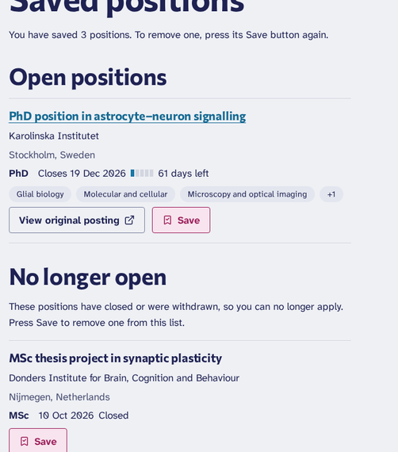

- **Principle**: feedback, affordance.
- **What**: once a position is saved, its button turns pink and its icon gains a tick, but the word stays "Save" (as built in M4b, D49: a toggle whose label does not change, PLAN §7.5). The saved page then says "To remove one, press its Save button again". After signing in to save, the reader lands back on the list with nothing in words saying that it worked.
- **Built** (proposal A, D54): the button reads "Saved" once saved; the saved page says "To remove one, press its Saved button."

| Before | After |
|---|---|
|  | 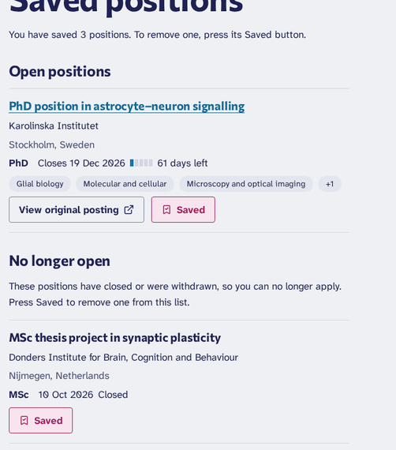 |

### 2. Searching for a field finds no positions (proposal C)

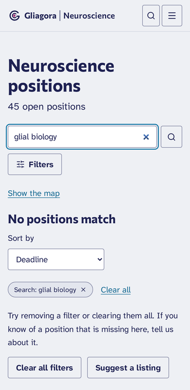

- **Principle**: feedback, wording.
- **What**: "glia" or "glial biology" in the jobs list's search box gives "No positions match", and the site search shows only the subfield's page, although two open positions carry the subfield Glial biology. The search reads titles, summaries and institutions, not tags. Typing one's field is the most natural first move.
- **Built** (proposal C, D56): the search also reads the English labels of a position's subfields, methods and model systems.

| Before | After |
|---|---|
|  | 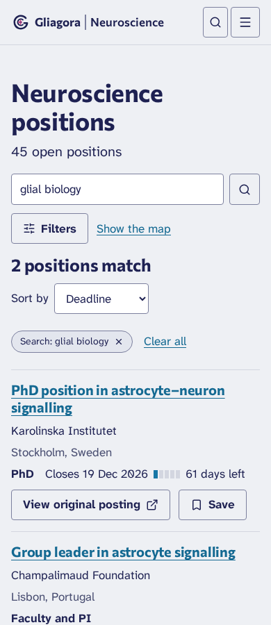 |

### 3. Five of the six windows lead to pages "being built" (proposal B)


- **Principle**: consistency, affordance.
- **What**: Events, Funding, Papers, News and Resources in the header, the phone menu, the footer and the 404 page, and Learn's two sections, all open a "being built" page, and the Events and Resources menus list sub-items (conferences, datasets…) that open the same page. At the launch, Jobs (with the map) is the only window that exists.
- **Built** (proposal B, D55): the header, the phone menu, the footer, the 404 page and search show only Jobs, then Map, Subfields and About; Learn waits in the footer until it is built.

| Before | After |
|---|---|
|  |  |

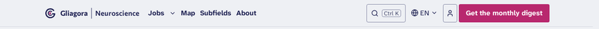

## 3. P2 findings

### Fixed

**7. On a phone, the first position starts far down the jobs list.** Principle: mobile ergonomics, hierarchy.

| Before | After |
|---|---|
| 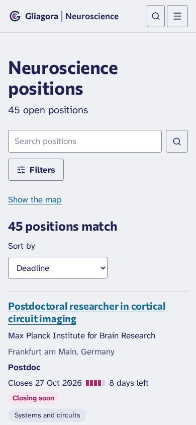 | 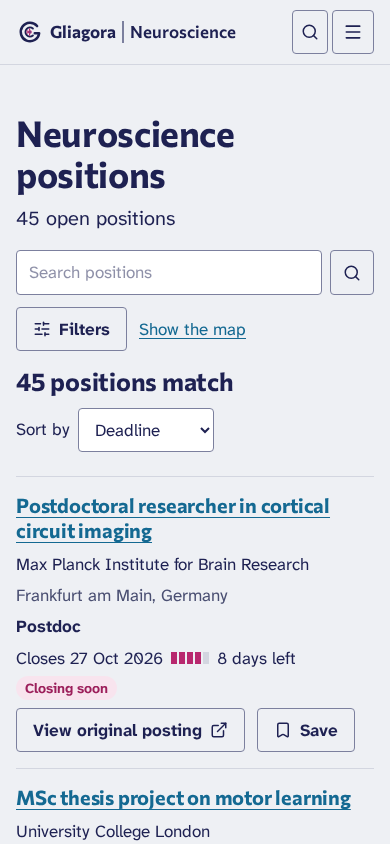 |

- **What**: the title, the count, the search box, "Filters", "Show the map" on a line of its own, "Sort by" above a full-width menu, then the first position at 580 px of an 844 px screen.
- **Fix**: "Show the map" sits beside "Filters", "Sort by" beside its menu (the menu is as wide as its longest choice), and the blocks are 16 px apart on phones instead of 24. The first position now starts at 477 px. On a desktop the map link ends the row of filter buttons where there is room (finding 9's image), and the sort menu is as wide as its choices.

**8. On a phone, each row is very tall.** Principle: mobile ergonomics, spacing.

| Before | After |
|---|---|
|  | 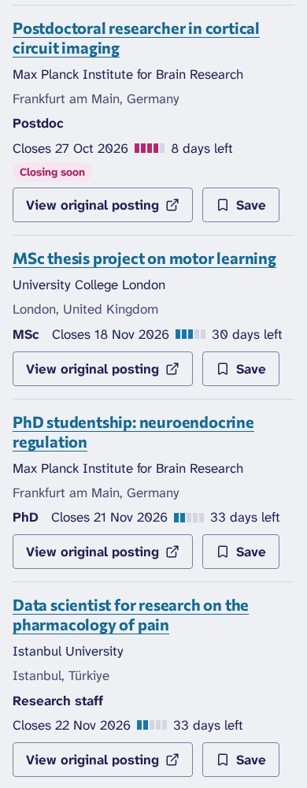 |

- **What**: up to four topic pills wrap onto two or three lines: rows of 280 to 400 px, two and a half to a screen.
- **Fix**: below 480 px the rows leave their topics to the job page, as the phone wireframe does (§9.4): rows of about 210 to 290 px. From 480 px they show as before.

**9. Two filter labels hide what they hold.** Principle: wording.

| Before | After |
|---|---|
| 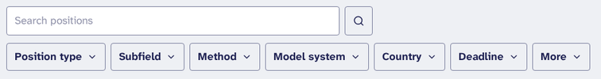 | 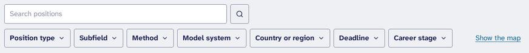 |

- **What**: "More" holds only the career stages; "Country" holds the regions too, so Europe showed as "Country (1)".
- **Fix**: "Career stage" and "Country or region" (Turkish: "Kariyer aşaması", "Ülke veya bölge", for the native speaker's review).

**10. The desktop filters apply at once, yet each popover asks for "Apply".** Principle: feedback, consistency.

| Before | After |
|---|---|
| 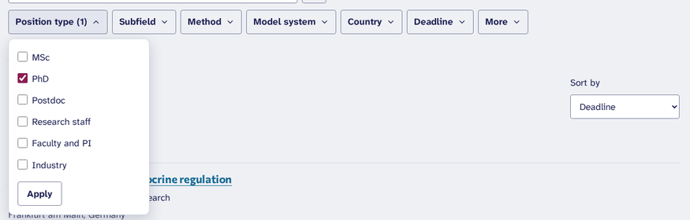 | 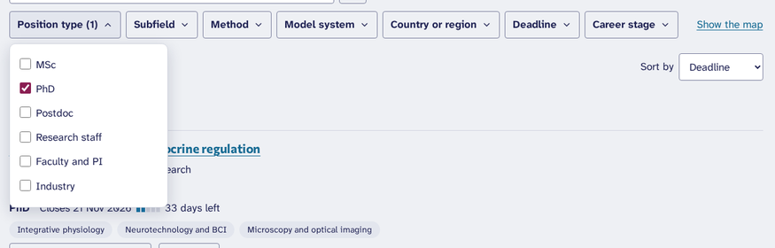 |

- **What**: with JavaScript a ticked box changes the list at once, behind the popover, while an "Apply" button suggests that nothing happened yet.
- **Fix**: with JavaScript, Apply shows only in the Deadline popover, whose two dates do wait for it; without JavaScript every popover keeps it. A tick also applies when the list's script cannot load (it then loads the page), so no popover is left without a way to apply.

**11. The phone menu's button does not show how to close it.** Principle: affordance, mobile ergonomics.

| Before | After |
|---|---|
| 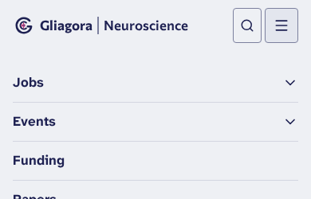 | 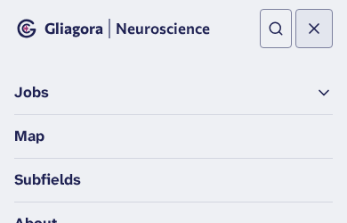 |

- **Fix**: while the menu is open, its button shows a cross (full and reduced header); its name stays "Menu", and screen readers hear that it is expanded.

**12. Breadcrumb links are small targets.** Principle: mobile ergonomics.

| Before | After |
|---|---|
|  | 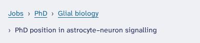 |

- **What**: 18 px high on a phone.
- **Fix**: at least 24 px (WCAG 2.5.8), with the same small text.

**13. The account pages' section headings are almost as large as the page's title.** Principle: hierarchy, consistency.

| Before | After |
|---|---|
| 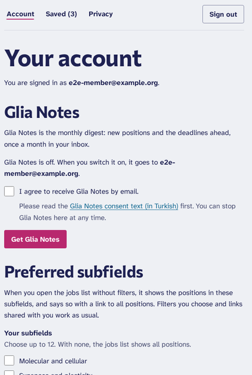 | 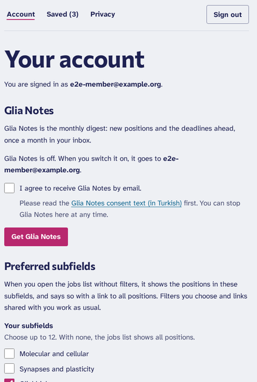 |

- **What**: five section headings at the H2 step (up to 39 px) under a 56 px title, in a narrow column, where the long-form pages and the job page use the H3 step for their sections.
- **Fix**: the sections of the account, saved, privacy and deletion pages take the H3 step (25 px), and "Change your email address" the card step (20 px).

**14. The archive's issue page starts with an eyebrow label and joins facts with dots.** Principle: §7.6.

| Before | After |
|---|---|
| 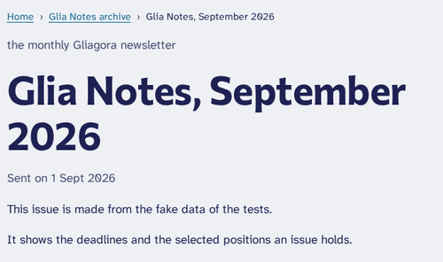 | 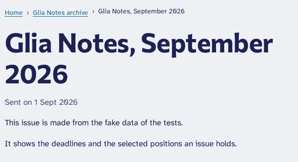 |
| 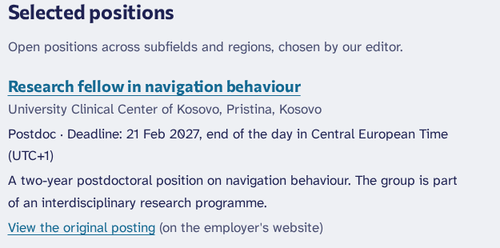 | 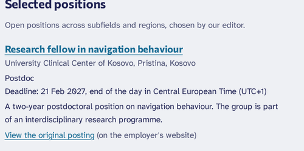 |

- **What**: "the monthly Gliagora newsletter" above the title, "Postdoc · Deadline: …" and "All issues · Subscribe": all three are template habits PLAN §7.6 rules out.
- **Fix**: the line above the title is gone (the breadcrumbs say where the reader is); the facts and the two links are separate elements. The email itself keeps its line and its dots: it was approved as built (D53), and a mail program shows no styles that would space the facts apart.

**15. The email has no viewport line.** Principle: mobile ergonomics.

| Before | After |
|---|---|
| 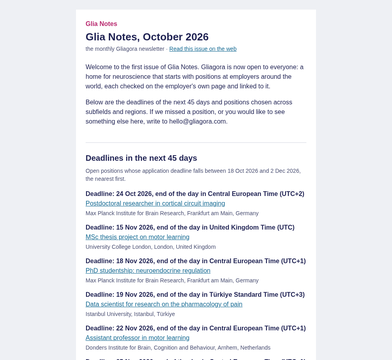 | 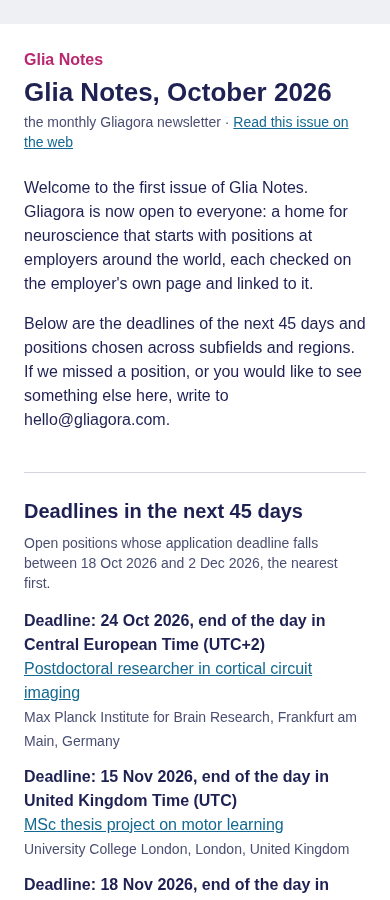 |

- **What**: without `<meta name="viewport">`, a mail app that honours it lays the issue out 980 px wide and scales it down, so its 16 px text reads at about 6 px on a phone.
- **Fix**: the line, in the issue's template (`src/lib/newsletter/issue/email.tsx`) and in the sample (`docs/glia-notes-sample/sample-issue.html`).

**16. The newsletter page promised papers and funding.** Principle: wording.

- **Before**: "The monthly Gliagora newsletter. One email a month: new positions, upcoming deadlines, papers and funding."
- **After**: "The monthly Gliagora newsletter. One email a month: new positions and the deadlines ahead, with papers and funding as those parts of Gliagora open." The page's description (search engines, link previews) likewise.

**17. The home page's "What you will find here" leaves out PhD.** Principle: consistency.

| Before | After |
|---|---|
| 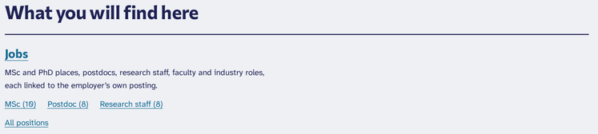 | 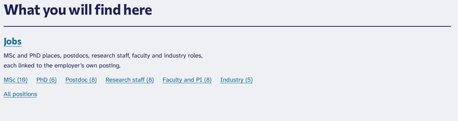 |

- **What**: only the three position types with the most positions, so a PhD seeker saw MSc, Postdoc and Research staff.
- **Fix**: every type with open positions, in the taxonomy's order, each with its count.

**18. A subfield's page does not lead on to the jobs list.** Principle: affordance.

| Before | After |
|---|---|
| 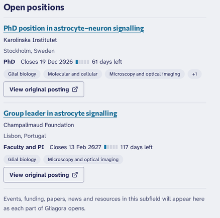 | 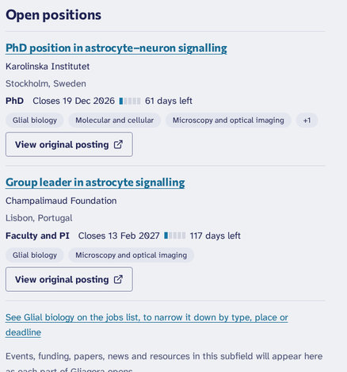 |

- **What**: with up to ten positions shown, the hub had no link to the list, where they can be narrowed by type, place or deadline.
- **Fix**: always a link: "All 24 positions in …" when not all are shown, "See Glial biology on the jobs list, to narrow it down by type, place or deadline" when they are.

**19. Search shows "19 subfields" but five, with no way to the rest.** Principle: feedback.

| Before | After |
|---|---|
| 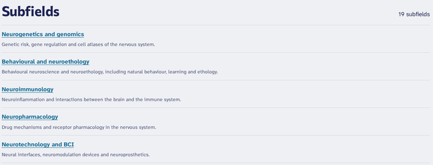 | 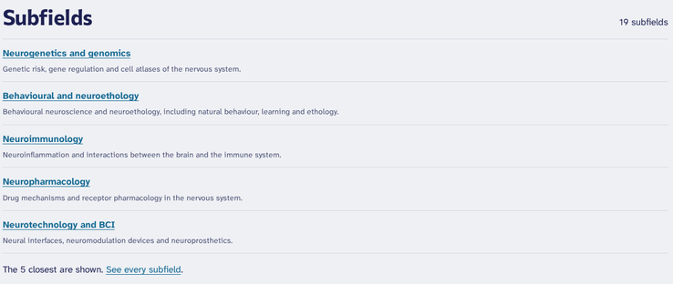 |

- **Fix**: "The 5 closest are shown. See every subfield.", as the institutions already say.

**20. The 404 and 410 pages' links read as words with dots between them.** Principle: consistency, §7.6.

| Before | After |
|---|---|
| 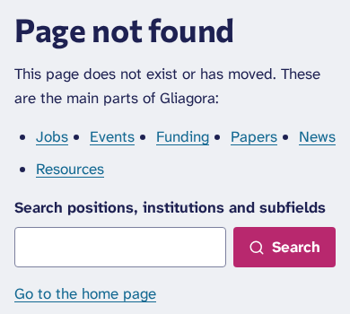 | 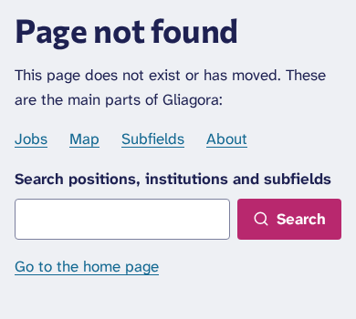 |

- **What**: the long-form pages' bullets, drawn after each word in a row.
- **Fix**: a row of links without bullets.

**21. The map's list of institutions does not look clickable.** Principle: affordance.

| Before | After |
|---|---|
| 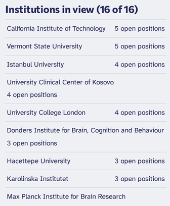 | 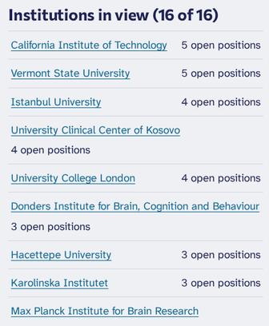 |

- **What**: each row opens the institution's panel, but looked like a table row: no underline, the default cursor.
- **Fix**: the institution's name in the link colour, underlined, and the pointer cursor.

**22. A withdrawn position shows a date still to come next to "Closed".** Principle: wording.

| Before | After |
|---|---|
| 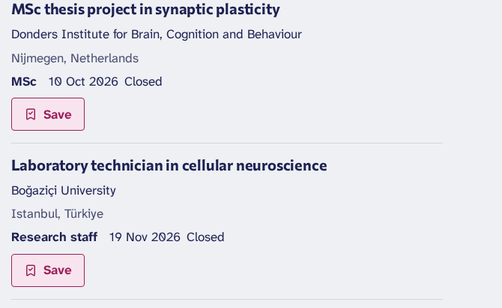 | 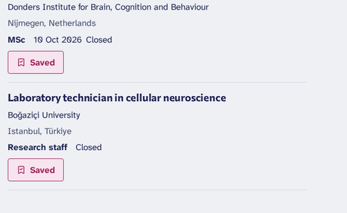 |

- **What**: on the saved page, "19 Nov 2026 Closed" for a position withdrawn before its deadline, which reads as a deadline still open.
- **Fix**: a position that closed before its deadline day ended (filled or withdrawn) shows "Closed" alone in lists; one that closed on its day keeps "10 Oct 2026 Closed". The job page is unchanged.

**23. The reduced header of the M2 state has no link on a desktop.** Principle: consistency.

| Before | After |
|---|---|
| 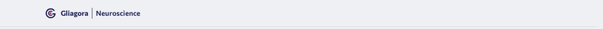 | 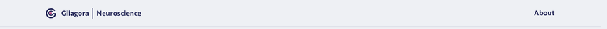 |

- **What**: About was in the phone menu only; on a desktop the header held the logo alone.
- **Fix**: About beside the language and Glia Notes buttons from 768 px, as in the phone menu.

### Proposed (section 6)

- **4. After signing in to save, nothing says in words that the position was saved** (feedback); the header looks the same signed in or out, since it is the same for everyone so that pages stay static (D49). **Built** with proposal A (D54): back on the list, the button reads "Saved".
- **24. No counts beside the filter options**, so a reader can walk into "No positions match" (feedback). Proposal D, **not chosen for now**: after the launch, with real positions.
- **25. The candidate's "Extracted facts", "Suggested tags" and "AI draft" are raw JSON in the admin** (affordance, for the editor). **Built** (proposal E, D57): a panel in plain words above them; the JSON is folded under "The same as data (JSON)".
- **26. Once a candidate is accepted, the way to its draft job is a small pencil in a greyed field** (affordance). **Built** (proposal E, D57): "Open the draft job" in the sidebar.
- **57. No way to browse by subfield from the home page or the Jobs menu, though the hero says "every subfield"** (hierarchy). **Built in part** (proposal F1, D58): Subfields in the Jobs menu and, with D55, in the header; the home page's row of subfields (F2) was not chosen.

| Before | After |
|---|---|
| 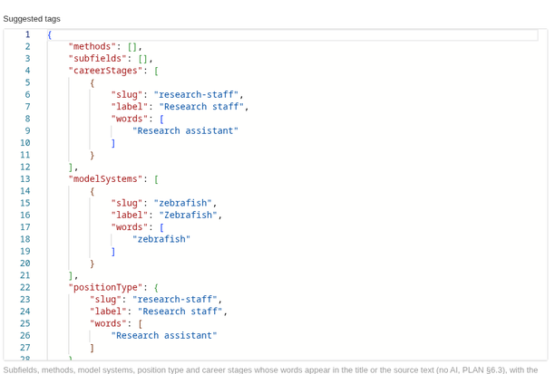 | 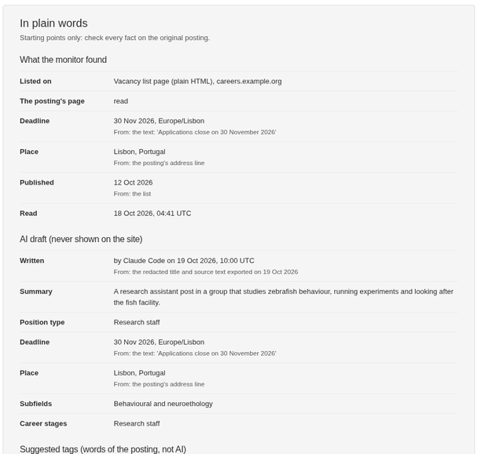 |
| 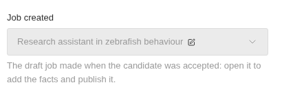 | 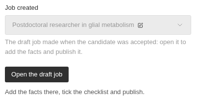 |

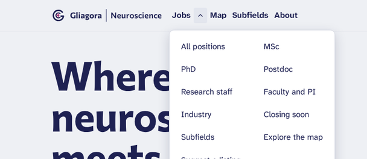

### Left as they are

- **27. The header's pink "Get the monthly digest" competes with each page's own action** (hierarchy). PLAN §8.2 adopted one persistent header call to action; the operator could revisit it, but nothing here is broken.
- **28. Several names for one newsletter** ("Glia Notes", "the monthly digest") (wording). "Get the monthly digest" is the button PLAN §8.2 and §9 name; "Glia Notes" is its name. Kept; the description was made accurate (finding 16).
- **29. The deadline gauge reads like a progress bar** (affordance). It is decorative by design and the words say the days left (§7.5, §7.6 "dense list rows with a deadline gauge").
- **30. Topic pills on rows look like the removable filter chips but do nothing** (affordance, consistency). Making every row's topics links would add many links to each row of the list; on phones they are now hidden (finding 8).
- **31. The account page is long, with five primary buttons** (hierarchy). The headings are smaller now (finding 13); one primary button per form is how the site's forms work.
- **32. A long paragraph about the spam check before each form's button** (wording). It tells people what is kept and why at the moment of collection, which the privacy texts rely on; a shorter one is a question for the lawyer's review, not for this pass.
- **33. The home page's figures have playful captions, and "1 deadline this month" is a weak figure on 20 October** (wording, hierarchy). Both are PLAN §8.2 and §9.1 decisions ("Consider this your action potential"); the operator may change the copy at any time.
- **34. On a phone the hero poster takes about 330 px, and its "Jobs" label floats below the brain** (hierarchy). The poster is out of this task's scope (M13, `tools/poster`); a smaller poster on phones would be a proposal for M13.
- **35. On a phone, the jobs list's map view puts the map and its institutions before the positions** (mobile ergonomics). The map view is something the reader asks for; the list view is the default.

## 4. P3 findings (left)

| # | Finding | Where | Principle |
|---|---|---|---|
| 36 | "Similar positions" can be weakly related (a pain-pharmacology data scientist beside a PhD in astrocyte–neuron signalling) | job page | consistency |
| 37 | The desktop header lacks Map, Learn and About, which the phone menu has | header from 1280 px | consistency |
| 38 | The footer's heading "Windows" is the project's own word; "Contact and legal notice" appears twice | footer | wording |
| 39 | Emails say "Gliagora \| Neuroscience" in sentences | emails | wording |
| 40 | "21 Sept 2026" beside "27 Oct 2026" (British English abbreviates September with four letters) | job page, "Last verified" | consistency |
| 41 | On a phone a long breadcrumb's second line starts with "›" | job page | spacing |
| 42 | The empty list shows "Clear all" and "Clear all filters", and "Sort by" with nothing to sort | jobs list, no results | consistency |
| 43 | The sign-in "Check your inbox" page does not show the address, while the newsletter's does | sign-in | feedback |
| 44 | The suggest form asks for an address and, separately, for the tick to be emailed | suggest form | wording |
| 45 | On a phone the account's sub-navigation puts "Sign out" on a line of its own | account pages | mobile ergonomics |
| 46 | About repeats the logo under its title and says "six windows" | About | wording |
| 47 | "ROR record" is not explained; rows on institution and hub pages have no Save | institution, hub | wording, consistency |
| 48 | A closed position's page still offers Save | job page, closed | hierarchy |
| 49 | The phone filter sheet does not dim the page behind it, as the search dialog does | jobs list, phone | consistency |
| 50 | The same position can be in "Latest positions" and in "Deadlines coming up" | home | spacing |
| 51 | The language menu offers English only | header | affordance |
| 52 | In dark mode the topic pills and the gauge's empty segments are close to the background (decorative; text contrast passes) | lists, dark | contrast |
| 53 | The search dialog shows no suggestions as one types, only "Press Enter to see the results" | search dialog | feedback |
| 54 | The Jobs menu's two columns read row by row, mixing types with actions | header, Jobs menu | consistency |
| 55 | The map's institutions list: a long name pushes its count onto a line of its own | map | spacing |
| 56 | The draft legal texts show "[TO DECIDE: …]" notes; none may reach the public (they do not: drafts are private) | legal drafts | wording |

The screenshots of these stay on the operator's computer with the other 190; none is needed to act on them.

## 5. Not findings

- **5. "The map looks broken"** (the reviewer's P1): locally the basemap is not served (`/basemap/` exists only on the server), so the pins sat on grey. With the test basemap the map draws as on the server, its pins carry their numbers, and the half-drawn strip in the first full-page screenshot was the screenshot tool's resize, not the map.
- **6. "The pre-launch site offers no way to sign up"** (the reviewer's P1): the coming-soon page and the reduced header show the signup as soon as the açık rıza metni is approved (D50); that is the order of M2's steps, not a fault. Finding 23 came out of looking at it.

## 6. Proposals for the operator

Each changes a recorded decision, the navigation, the search or the admin, so it waited for the operator, who was asked in the Claude Code session on 2026-10-21 and chose **A, B, C, E and F1** (D54–D58), not D or F2. The chosen ones were built in the same pull request as the fixes, so the whole pass took one CI run.

### A. "Saved" on the Save button once saved (finding 1, P1)

```
 Not saved                     Saved
┌──────────┐                  ┌───────────┐
│ ⌑  Save  │   press   →      │ ⌑✓ Saved  │  (pink, as now)
└──────────┘                  └───────────┘
 Saved page: "To remove one, press its Saved button."
```

- **What changes**: the word follows the state; the filled style and the tick stay. Screen readers keep hearing a toggle button ("Saved, toggle button, pressed").
- **Cost**: about an hour: the two words are both in the page and CSS shows the one for the button's state, so no script changes and no JavaScript is added; one message, two Turkish strings for review, the tests that read the label. It changes what PLAN §7.5 records as built for D49.
- **Recommendation**: yes. It is the one P1 a visitor meets on every saved position.
- **Decision**: chosen; built (D54).

### B. Show only the windows that are open (finding 3, P1)

```
Now:    Gliagora | Neuroscience  Jobs▾ Events▾ Funding Papers News Resources▾  [⌕] [EN] [👤] [Get the monthly digest]
After:  Gliagora | Neuroscience  Jobs▾ Map Subfields About                      [⌕] [EN] [👤] [Get the monthly digest]
```

- **What changes**: the header, the phone menu, the footer's first column and the 404 page list only the windows in `LIVE_WINDOWS` (Jobs, until M8), plus Map, Subfields and About, which exist. Learn (two sections, both being built) leaves the footer too. The placeholder pages stay at their addresses, not indexed, until each milestone adds its window back, which then appears everywhere at once.
- **Cost**: two to three hours (`src/lib/site.ts`, `src/lib/navigation.ts`, the header, footer and 404, their tests and the layout checks); nothing on the jobs list's budget. It changes the §9.1 header (six windows) until M8 to M10.
- **Recommendation**: yes, before the launch: a visitor who opens three empty sections in a row stops trusting the first.
- **Decision**: chosen; built (D55).

### C. Search also finds positions by their subfields, methods and model systems (finding 2, P1)

```
Search positions: [ glial biology        ] (⌕)
2 positions match
  PhD position in astrocyte–neuron signalling      (tagged Glial biology)
  Group leader in astrocyte signalling             (tagged Glial biology)
```

- **What changes**: the jobs list's search and the site search match the names of a position's subfields, methods and model systems as well as its title, summary and institution. The site search's "Positions" then lists the two positions for "glia".
- **Cost**: about half a day: the search SQL in `src/lib/search/`, a migration for the index it uses (a raw-SQL migration with its own `down`), the plan checks of `pnpm test:db`, and tests. No JavaScript.
- **Recommendation**: yes, before the launch: people type their field first.
- **Decision**: chosen; built (D56), in the end without a migration: the matching terms are few (about 120 in all), and their positions are found through the existing index on the tags' table.

### D. Counts beside the filter options (finding 24)

```
Subfield ▴
  [ ] Molecular and cellular (6)
  [ ] Glial biology (2)
  [ ] Neuroethics, education and society (0)   ← greyed, still choosable
```

- **What changes**: each option shows how many positions it would add, given the other filters, and options with none are marked.
- **Cost**: about a day: one counting query per filter on every load of the list, server-rendered (no JavaScript), about 2 KB more HTML on the list (its budget is 60 KB). The counts need care to stay equal to what the list then shows.
- **Recommendation**: later, after the launch, with real positions: with the fake data most counts are 0 to 3, and the gain is clearest with a few hundred positions.
- **Decision**: not chosen for now.

### E. A readable candidate in the admin (findings 25 and 26)

```
Suggested tags      Subfields: none found   Methods: none found
                    Model systems: Zebrafish ("zebrafish")
                    Position type: Research staff ("Research assistant")
AI draft            Summary: "…"   Type: Postdoc   Deadline: 2026-11-30 (Europe/Berlin)
Extracted facts     Deadline 2026-11-30, from the posting's JSON-LD …
[ Open the draft job ]   (once accepted)
```

- **What changes**: above the JSON fields (kept, folded, for the technical administrator), a read-only panel says in plain words what the monitor found, which tags it suggests and what the AI draft holds; once accepted, a button opens the draft job.
- **Cost**: about half a day: one custom admin component (as the issues' sidebar), `pnpm generate:importmap`, an admin end-to-end test, and the editor guide's sections 3, 5 and 6. No change to the public site.
- **Recommendation**: yes: it is the editor's most frequent screen, and Nuray should not read JSON.
- **Decision**: chosen; built (D57). The editor guide's sections 3, 5 and 6 say where to find the panel and the button.

### F. Browse by subfield (finding 57)

```
Jobs ▾  All positions    MSc      …
        Subfields        PhD
Home:   "Positions by subfield": Glial biology (2) · Systems and circuits (7) · …   (as links, without dots)
```

- **What changes**: "Subfields" in the Jobs menu; and on the home page, under the two lists, the subfields with open positions as links to the filtered list, with their counts (as "Open positions by country" does).
- **Cost**: the menu link, half an hour; the home section about two hours (one counting query, kept 10 minutes like the figures; the home page's structure in §9.1 gains a row; the home tests check each count against its list).
- **Recommendation**: the menu link yes; the home section yes if the operator wants the field to be a way in on the home page, which the hero's "every subfield" promises.
- **Decision**: the menu link chosen and built (D58; with D55, Subfields is in the header too); the home section not chosen.

## 7. Budgets

- **JavaScript**: the jobs list 136.74 KB before and after (its cap is 137 KB, D47); ordinary pages 134.83 KB before (PLAN §17.3) and 134.84 KB after (budget 140 KB). No script was added: the "Saved" label is CSS, and the panel of D57 is in the admin, which has no budget.
- **CSS**: 10.33 KB before, 10.46 KB after, gzip (budget 35 KB).
- **HTML**: the jobs list 23.6 KB (budget 60 KB).
- **Lighthouse as a phone, the browser slowed down for real** (`pnpm lighthouse:local --form mobile`, the fake data, 17 templates):

| | Performance | Accessibility | LCP | CLS | TBT |
|---|---|---|---|---|---|
| Before (main, 7ae2a09) | 96 to 100 | 100 | 1.5 to 1.6 s | 0 | 16 to 91 ms |
| After | 96 to 100 | 100 | 1.5 to 1.6 s | 0 | 15 to 84 ms |

  The lowest scores are the map's pages (96 and 97, both times: MapLibre's work on a slowed processor); every target and budget of §17 is met. Lighthouse's estimate as a desktop was not run again: it gave 100 everywhere on 2026-10-07 and 2026-10-16, and nothing here adds weight.

## 8. The admin's two most frequent flows

Counted in the local admin with the test editor, on a suggestion that became a candidate (a monitor's candidate has its institution already, so one step fewer).

- **Deciding a candidate**: open "Candidates" (1) → the candidate (1) → its original posting, in a new tab (1) → Institution: type a few letters and choose (2) → Status "Accepted" (2) → Save (1): **8 clicks and 2 fields**. Rejecting: Status (2), Reason (2), Save (1) once the candidate is open. In bulk (since #102): tick, Edit, Status, Reason, Save.
- **Publishing the job made from it**: the draft opens with its title, institution, position type, career stages, model systems, original posting, language and time zone filled. Still to do: open it (the pencil in "Job created", 1) → Subfields (2) → Deadline day (2) → Summary (typed) → the five checklist boxes (5) → Last verified (2) → Status "Published" (2) → Save (1): **about 17 clicks, 4 fields and 5 boxes**, on a form of 49 fields of which about 30 can be edited. A first Save that misses something lists every missing field by name and marks it in red, which works well.
- **After** (D57): the candidate's facts, suggested tags and AI draft read in plain words at the top of its page, so the editor compares them with the original posting without reading JSON, and the draft job opens with one press on "Open the draft job" in the sidebar. The counts above stay the same. Two smaller ideas, left for later: the job's sidebar has 20 read-only system fields (short ID, slug, closing time, link check…) above and below "Last verified", which could fold into one closed group; and "Last verified" could offer today with one click.
